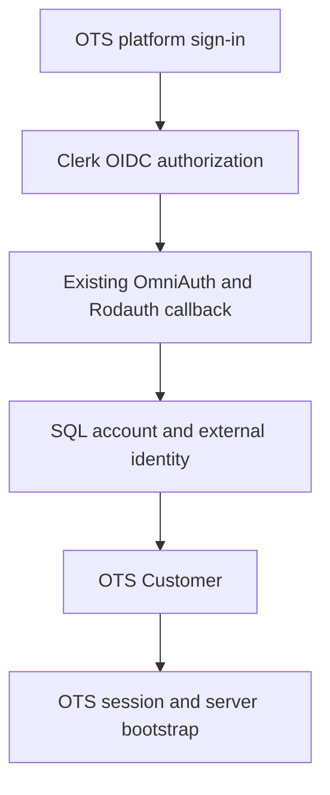

# Clerk platform OIDC compatibility spike

**Status:** Agreed investigation scope; integration compatibility unverified.

## Summary

The recommended investigation evaluates Clerk as an optional platform-level OIDC identity provider through the existing server-side authentication integration. It serves two purposes: a potential authentication option for self-hosters and an additional development IdP alongside Microsoft Entra Dev accounts. This is a bounded compatibility spike, not a decision to introduce a new authentication mode or replace existing authentication options.

## Goals

- Establish whether Clerk works through the existing generic platform OIDC configuration.
- Exercise the server-side SSO flow with a second provider, including callbacks, identity linking, provisioning and local-session establishment.
- Identify the configuration, compatibility gaps and operational limitations relevant to self-hosters.
- Produce evidence for a subsequent product integration decision.

## Non-goals

- Replacing `simple`, `full`, generic OIDC or Entra authentication.
- Removing the auth database.
- Selecting the final architecture for every Clerk use case.
- Treating Clerk testing as a replacement for Entra-specific coverage.

## Recommended boundary

The spike uses `full` mode and the existing generic platform OIDC provider, without a Clerk Vue SDK or a new Clerk-specific strategy unless compatibility evidence establishes a need for one.

The expected flow is:

This flow is an investigation target, not a verified Clerk integration. The auth database remains part of full-mode authentication; Customer and session persistence remain separate application responsibilities.

## Evidence and architectural assessment

The following references describe the inspected implementation or external provider documentation. They do not establish end-to-end compatibility.

- The [generic OIDC definition](../../lib/onetime/sso_provider/oidc.rb) configures discovery, authorization code, PKCE and `openid email profile` scopes. Its route and display name are configurable through `OIDC_ROUTE_NAME` and `OIDC_DISPLAY_NAME`.
- The [auth application](../../apps/web/auth/application.rb) is selected for full mode. [Account provisioning](../../apps/web/auth/operations/ensure_customer_for_account.rb) connects SQL accounts to OTS Customers.
- The [Customer session evaluator](../../lib/onetime/session/customer_session_evaluator.rb) and [frontend auth store](../../src/shared/stores/authStore.ts) are the application session and bootstrap boundaries; a Clerk frontend sign-in alone does not establish that application identity.
- Clerk's [OAuth and OIDC documentation](https://clerk.com/docs/guides/configure/auth-strategies/oauth/single-sign-on) explicitly states: “For OpenID Connect (OIDC) sign-in, Clerk acts as the identity provider (IdP).” It documents OAuth applications, discovery information and the `openid` scope for issuance of an ID token.

### Alternatives retained for later evaluation

Relative effort and fit below are architectural assessments, not measured implementation estimates.

| Approach | Expected effort and fit | Development SSO coverage |
| --- | --- | --- |
| New authentication mode alongside `simple` and `full` | Broadest change: mode selection, bootstrap contracts, capabilities, account controls and session ownership need definition. A provider-neutral name such as `external` is a possibility, not an agreed name. | A separate authentication path does not inherently exercise the existing server-side SSO machinery. |
| Clerk SPA sign-in within `simple` | Feasible as a server-verified token exchange into an OTS session, with durable issuer/subject mapping, provisioning, linking and coordinated logout. It could bypass SQL auth storage for this path, but not Customer/session persistence. | Primarily tests a new bridge rather than the existing OIDC callback path. |
| Server-side platform OIDC | Closest reuse of the existing integration; the initial hypothesis is configuration-only compatibility. Retains full mode and its auth database. | Exercises the existing generic OIDC flow and complements Entra-specific testing. |

Neither SPA alternative is rejected. SQL-free Clerk authentication is a separate possible requirement, not a condition of this spike. Whether Clerk merely establishes an OTS session or remains authoritative throughout that session's lifetime is unresolved for those alternatives.

## Scope and requirements

The investigation covers platform sign-in on the installation's canonical host, not organization-specific custom-domain SSO.

The compatibility result covers:

- Discovery metadata, exact issuer matching, authorization code with PKCE, token-endpoint client authentication and registered callback behavior.
- Subject, email and email-verification claims required by local provisioning and linking policy.
- First login, repeat login, existing-email collisions and explicit account linking.
- User cancellation, failed callbacks and state/nonce validation.
- OTS logout when a Clerk IdP session remains active, including subsequent sign-in behavior.

The spike does not presume global IdP logout, continuous Clerk revocation checks or account-deletion synchronization. Its findings distinguish observed behavior from untested behavior and from desired future behavior.

### Proposed investigation constraints

These constraints describe the intended spike, not claims of verified security or compatibility:

- Existing authentication and account-linking checks remain in effect; successful integration does not depend on weakening them.
- Credentials remain server-side and are absent from committed configuration, browser bundles and recorded test evidence.
- Development testing uses dedicated test identities and non-production data. Clerk receives the authentication traffic and identity information involved in those flows.
- Other configured authentication methods are not replaced as a product requirement. Any local use of the generic OIDC slot is explicit about displacing its previous configuration.

## Dependencies and configuration boundary

- A Clerk development instance with OAuth application functionality available.
- A Clerk **OAuth application** with the required scopes, OAuth client credentials and registered OTS callback URI. Vue SDK publishable/secret keys are not substitutes for these client credentials.
- A full-mode OTS development installation with its auth database and Customer/session backing services.
- The existing generic OIDC settings: `OIDC_ISSUER`, `OIDC_CLIENT_ID`, `OIDC_CLIENT_SECRET` where required, and optional route/display customization.

The generic OIDC definition provides one configured platform provider slot. Using that slot for Clerk is distinct from supporting Clerk and another generic OIDC provider simultaneously. Entra has a separate provider definition; multi-provider registration changes are outside this spike.

## Out of scope

- Clerk CLI initialization or automatic framework scaffolding.
- Vue SDK installation, Clerk UI components and frontend bearer-token authentication.
- A new auth mode or simple-mode token-exchange endpoint.
- Auth database removal, migration or replacement.
- A dedicated Clerk provider entry or multiple generic platform OIDC registrations.
- Tenant/custom-domain SSO configuration and Clerk-to-OTS organization mapping.
- Production rollout, automated global logout, revocation propagation or account-deletion synchronization.

## Acceptance criteria

The spike is complete when it produces a reproducible compatibility result, including failures or blockers. Completion does not require declaring Clerk supported.

1. The result identifies the tested Clerk instance type, OTS revision, relevant dependency versions, non-secret configuration and callback requirements.
2. Discovery, issuer, PKCE, client authentication and claim compatibility each have an observed result or a named blocker.
3. First login either provisions the expected local identity and workspace through the existing path or has a documented failure. Repeat login is checked for resolution to the same identity without duplicate provisioning.
4. Existing-email collisions and explicit linking have recorded outcomes under the configured trust policy; successful fresh-account login alone is not considered sufficient evidence.
5. Cancellation, callback failure and state/nonce validation have recorded results, with any untested cases explicitly identified. Rejected authentication attempts do not establish a new authenticated OTS session.
6. Local logout and subsequent sign-in are checked with an existing Clerk IdP session. The result states what terminates locally and what remains active upstream.
7. Findings classify the outcome as configuration-only compatibility, compatibility requiring named changes, or blocked compatibility. Required changes are not silently folded into a broader authentication redesign.

## Open questions

- Does the installed OIDC strategy interoperate with Clerk's discovery metadata, client-authentication requirements and claims without changes? A live flow closes this question.
- What development callback/domain constraints and OAuth application availability apply to the selected Clerk instance? Dashboard configuration and a live flow establish the answer.
- Do observed email and verification claims satisfy the existing provisioning and linking policies? Recorded fresh-user and collision/linking outcomes establish the answer.
- Is documented generic OIDC configuration sufficient for self-hosters, or is a dedicated Clerk entry needed for coexistence or usability? That product decision follows the compatibility result.
- Is SQL-free Clerk authentication important enough to justify a separate simple-mode bridge or external mode? This remains a requirements decision independent of the spike.

## Decision after the spike

A successful result supports considering Clerk documentation as a tested generic OIDC configuration. It does not automatically establish production support or select a SPA integration. Compatibility gaps, coexistence requirements and any demand for SQL-free authentication inform separate follow-up decisions.
